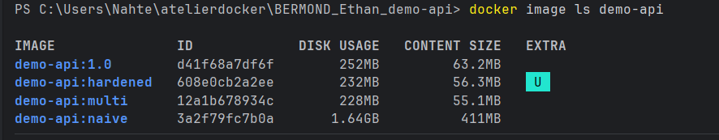
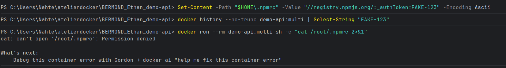
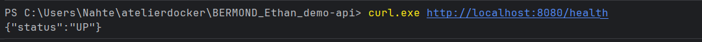

# Quête 4 : demo-api en multi-étapes

## Résumé des actions effectuées

- Création de `api/Dockerfile.naive` : repère de comparaison non optimisé (base complète `node:22`, `COPY . .`, `RUN npm ci` avec les dépendances de dev).
- Création de `api/Dockerfile.multi` :
    - Étape `deps` (`node:22.11-alpine`) : installation des dépendances de production (`npm ci --omit=dev`) avec montage du secret via `--mount=type=secret`.
    - Étape `runtime` (`node:22.11-alpine`) : copie uniquement de `node_modules` depuis `deps` et des fichiers nécessaires (`server.js`, `db.js`, `package.json`) avec `--chown=node:node`, passage sur `USER node` et ajout du `HEALTHCHECK`.
- Build des deux images et comparaison des tailles (`docker image ls demo-api`).
- Vérification de l'absence de fuite du secret `FAKE-123` dans l'historique et le système de fichiers.

## Fichiers Dockerfile (`api/Dockerfile.naive` et `api/Dockerfile.multi`)

### `api/Dockerfile.naive`

```dockerfile
FROM node:22
WORKDIR /app
COPY . .
RUN npm ci
CMD ["node", "server.js"]
```

### `api/Dockerfile.multi`

```dockerfile
# syntax=docker/dockerfile:1
FROM node:22.11-alpine AS deps
WORKDIR /app
COPY package.json package-lock.json ./
RUN --mount=type=secret,id=npmrc,target=/root/.npmrc npm ci --omit=dev

FROM node:22.11-alpine AS runtime
WORKDIR /app
COPY --from=deps --chown=node:node /app/node_modules ./node_modules
COPY --chown=node:node server.js db.js package.json ./
USER node
HEALTHCHECK --interval=30s --timeout=3s --start-period=5s --retries=3 \
  CMD wget --no-verbose --tries=1 --spider http://localhost:3000/health || exit 1
CMD ["node", "server.js"]
```

## Comparaison de taille avant / après (`docker image ls demo-api`)

**Commande :**
```text
$ docker image ls demo-api
```
**Résultat :**
```text
IMAGE               ID             DISK USAGE   CONTENT SIZE   EXTRA
demo-api:1.0        d41f68a7df6f        252MB         63.2MB
demo-api:hardened   608e0cb2a2ee        232MB         56.3MB   U
demo-api:multi      12a1b678934c        228MB         55.1MB
demo-api:naive      3a2f79fc7b0a       1.64GB          411MB
```



| Image | Disk Usage | Content Size | Ratio |
| :--- | :--- | :--- | :--- |
| `demo-api:naive` (Avant) | 1.64 GB | 411 MB | 1× (Référence) |
| `demo-api:multi` (Après) | 228 MB | 55.1 MB | **7,2× plus petit** (7,4× sur Content Size) |

## Preuves du secret de build et de fonctionnement

### 1. Absence du token `FAKE-123` dans `docker history`
**Commande :**
```text
$ docker history --no-trunc demo-api:multi | Select-String "FAKE-123"
```
**Résultat :**
```text
(aucune ligne)
```

### 2. Absence de `/root/.npmrc` dans l'image finale
**Commande :**
```text
$ docker run --rm demo-api:multi sh -c "cat /root/.npmrc 2>&1"
```
**Résultat :**
```text
cat: can't open '/root/.npmrc': Permission denied
```



### 3. Test de santé de l'API (`/health`)
**Commande :**
```text
$ docker run --rm -p 8080:3000 demo-api:multi
$ curl.exe http://localhost:8080/health
```
**Résultat :**
```text
{"status":"UP"}
```



## Liens

- Repo GitHub : https://github.com/ynov-x-anthony/BERMOND_Ethan_demo-api