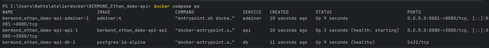
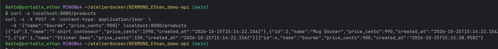
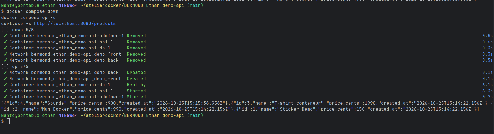

# Projet demo-api — Stack Docker Compose (Étape 4)

Déploiement complet de la stack `demo-api` (API Node.js, PostgreSQL 16 et Adminer) orchestrée avec Docker Compose, incluant l'isolation réseau, la persistance des données, les healthchecks et la gestion des mots de passe via Docker Secrets.

## Prérequis

- **Docker** et **Docker Compose** (inclus dans Docker Desktop)
- **Git**

## Installation et démarrage

1. **Cloner le dépôt et configurer les variables d'environnement :**
   ```bash
   cp .env.example .env
   ```

2. **Créer le fichier secret contenant le mot de passe de la base de données :**
   ```bash
   echo -n "demo" > db_password.txt
   ```

3. **Lancer la stack en arrière-plan (avec build de l'API) :**
   ```bash
   docker compose up -d --build
   ```

## URLs des services

- **API (`demo-api`)** : http://localhost:8080 (Routes : `/`, `/health`, `/products`)
- **Adminer (Interface BDD)** : http://localhost:8081
    - *Système* : PostgreSQL
    - *Serveur* : `db`
    - *Utilisateur* : `demo` / *Mot de passe* : `demo` / *Base* : `demo`

## Repartir de zéro (Reset complet)

Pour arrêter les conteneurs, supprimer les réseaux **et** supprimer le volume de données `pgdata` :

```bash
docker compose down -v
```

---

## Preuves de fonctionnement et Tests

### 1. État des conteneurs (`docker compose ps` avec `db` healthy)

**Commande :**
```powershell
docker compose ps
```
**Résultat :**
```text
NAME                             IMAGE                        COMMAND                  SERVICE   CREATED          STATUS                            PORTS
bermond_ethan_demo-api-adminer-1 adminer:4                    "entrypoint.sh docke…"   adminer   10 seconds ago   Up 9 seconds                      0.0.0.0:8081->8080/tcp, [::]:8081->8080/tcp
bermond_ethan_demo-api-api-1     bermond_ethan_demo-api-api   "docker-entrypoint.s…"   api       10 seconds ago   Up 3 seconds (health: starting)   0.0.0.0:8080->3000/tcp, [::]:8080->3000/tcp
bermond_ethan_demo-api-db-1      postgres:16-alpine           "docker-entrypoint.s…"   db        11 seconds ago   Up 9 seconds (healthy)            5432/tcp
```



### 2. Test de l'API et persistance du produit « Gourde »

**Récupération initiale (`GET /products`) et ajout du produit « Gourde » (`POST /products`) :**
```bash
$ curl -s localhost:8080/products
curl -s -X POST -H 'content-type: application/json' \
  -d '{"name":"Gourde","price_cents":900}' localhost:8080/products
```
**Résultat :**
```text
[{"id":3,"name":"T-shirt conteneur","price_cents":1990,"created_at":"2026-10-25T15:14:22.156Z"},{"id":2,"name":"Mug Docker","price_cents":990,"created_at":"2026-10-25T15:14:22.156Z"},{"id":1,"name":"Sticker Demo","price_cents":150,"created_at":"2026-10-25T15:14:22.156Z"}]
{"id":4,"name":"Gourde","price_cents":900,"created_at":"2026-10-25T15:15:38.958Z"}
```



**Vérification de la persistance après `docker compose down` puis `docker compose up -d` :**
```bash
$ docker compose down
docker compose up -d
curl.exe -s http://localhost:8080/products
```
**Résultat :**
```text
[+] down 5/5
 ✔ Container bermond_ethan_demo-api-adminer-1 Removed    0.5s
 ✔ Container bermond_ethan_demo-api-api-1     Removed    0.6s
 ✔ Container bermond_ethan_demo-api-db-1      Removed    0.3s
 ✔ Network bermond_ethan_demo-api_demo_front  Removed    0.3s
 ✔ Network bermond_ethan_demo-api_demo_back   Removed    0.5s
[+] up 5/5
 ✔ Network bermond_ethan_demo-api_demo_back   Created    0.1s
 ✔ Network bermond_ethan_demo-api_demo_front  Created    0.1s
 ✔ Container bermond_ethan_demo-api-db-1      Healthy    6.1s
 ✔ Container bermond_ethan_demo-api-api-1     Started    6.3s
 ✔ Container bermond_ethan_demo-api-adminer-1 Started    0.7s
[{"id":4,"name":"Gourde","price_cents":900,"created_at":"2026-10-25T15:15:38.958Z"},{"id":3,"name":"T-shirt conteneur","price_cents":1990,"created_at":"2026-10-25T15:14:22.156Z"},{"id":2,"name":"Mug Docker","price_cents":990,"created_at":"2026-10-25T15:14:22.156Z"},{"id":1,"name":"Sticker Demo","price_cents":150,"created_at":"2026-10-25T15:14:22.156Z"}]
```



## Liens

- Repo GitHub : https://github.com/ynov-x-anthony/BERMOND_Ethan_demo-api